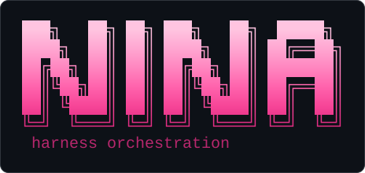
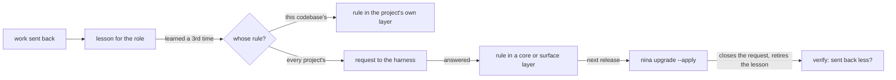
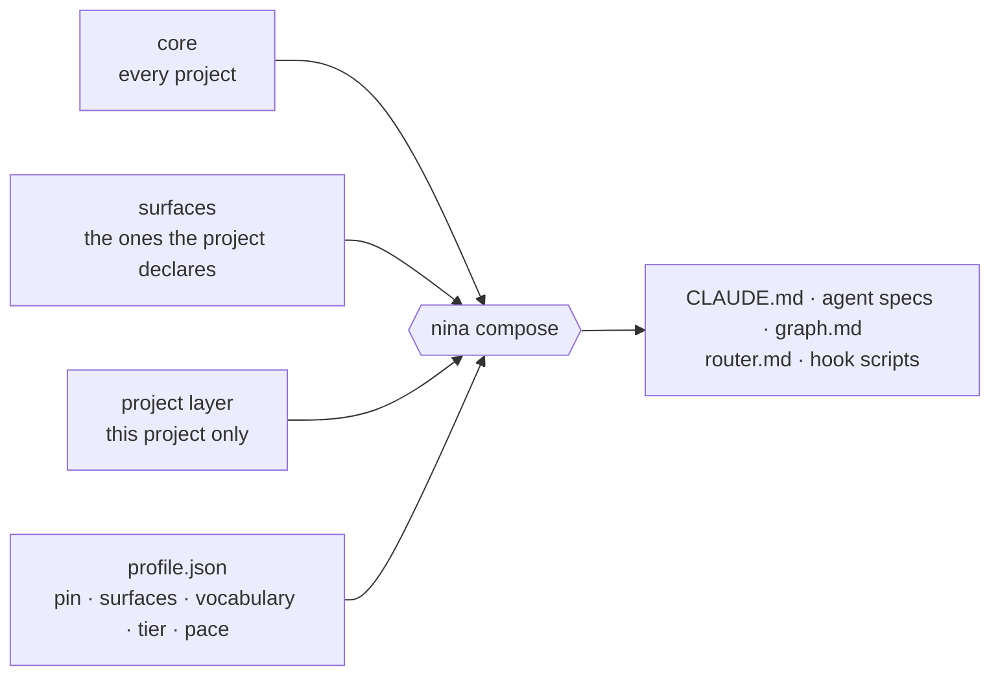
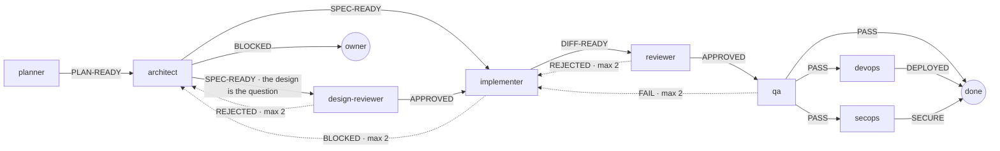
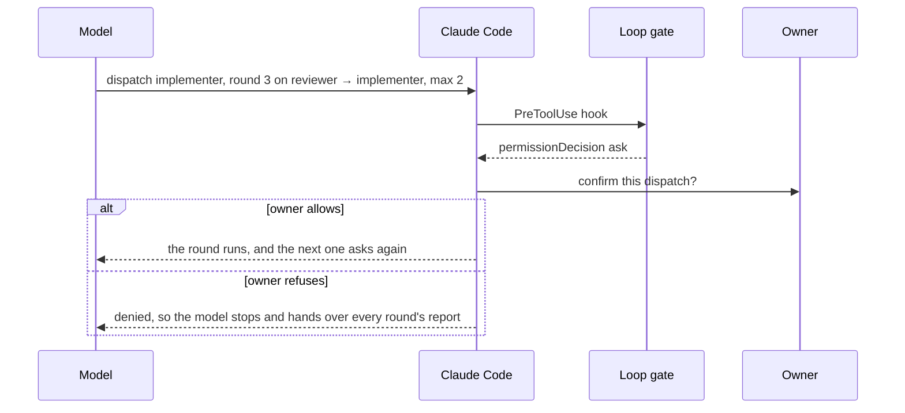

<p align="center">
  
</p>

NINA keeps one Claude Code agent harness in sync across every project that uses it.

A harness is everything that tells Claude Code how to work on a project: the `CLAUDE.md`, a dozen subagent
specs (planner, architect, reviewer, qa and the rest), the rules for which agent runs when, and the hooks.
NINA builds those files for each project from shared, versioned pieces. It uses hooks to enforce what a
prompt can only ask for, and it reads Claude Code's own transcripts to show what the agents actually did and
what it cost.

- [Why it exists](#why-it-exists)
- [Quick start](#quick-start)
- [Cookbook](#cookbook): one recipe per thing you'll want to do
- [How it works](#how-it-works): layers, the pipeline graph, the loop gate, learning
- [What measuring found](#what-measuring-found)

## Why it exists

My harness used to move between projects by copy-paste, and each copy started drifting the day it was made.
I'd fix a rule in one project and it stayed broken in the others. After a while nobody could tell which copy
was current.

So NINA treats the harness like source code with a compiler:

- The shared rules live in this repo, once. A project declares what it has (a database, payments, a
  frontend) and NINA builds that project's files from it.
- Nobody edits the output. Every composed file says which layer its text came from, and a hook refuses a hand
  edit, so a fix goes into the layer and every project gets it.
- Each project pins a frozen release. I can keep changing the harness without moving a project that's
  shipping, and moving forward is one command that backs out on its own if a check fails.
- It measures. A rule can read fine and still be ignored, so NINA counts what actually happened from the
  transcripts, and a lesson the agents keep relearning becomes a rule in the next release.

## Quick start

You need Node 20 or newer. NINA has no dependencies.

```bash
pnpm init                     # only if the project has no package.json yet
pnpm add -D -E @xhulz/nina    # an exact version, so the lockfile pins it
pnpm nina init
```

`init` sets everything up in one pass:

1. It looks at the repo to guess its surfaces: a Prisma schema means `db`, a wrangler config means `edge-cf`.
2. It asks what the project is, and one yes-or-no question for each surface no file could settle.
3. It writes `.nina/profile.json` (what the project has), `.nina/BRIEF.md` (your answer) and a to-do list.
4. It wires the Claude Code hooks and composes the harness files.

Then open a new Claude Code session. Its first answer starts from your brief and offers to work through
what's still missing with you, starting with the architecture.

Run `pnpm nina` with no command on a terminal to get a small shell: the banner once, then a `nina ›` prompt
with Tab completion and history.

## Cookbook

Most commands act on the current directory, or on the one `--project <dir>` names (`snapshot` and `stats`
take a project's name instead). `pnpm nina help --all` lists every command, and `pnpm nina <command> --help`
shows its options.

### Watch the agents work

```bash
pnpm nina dashboard                  # one page: office, tasks, pipeline, lessons, learning, stats
pnpm nina pipeline --view            # only the office, following the current session live
pnpm nina pipeline --view --replay   # play a session again from its start
```

Both print a link to a page served on your own machine; add `--open` to open the browser too. The office
draws each agent at its stage's desk, walking the work over to the next one. A question mark appears over
whoever is waiting on you, and there's a small party when a task passes. Beside the room is a timeline of
the session's tasks: who worked on each, and for how long.

To see the chain as text:

```bash
pnpm nina pipeline                       # every stage, its gates, what goes back, each stage's model and skills
pnpm nina pipeline --for "new feature"   # the chain one kind of task gets
```

### Check that a project is healthy

```bash
pnpm nina status          # one screen: pin, newest release, hooks, gate, check, the week's cost, learning
pnpm nina check           # is what the project declared about itself true?
pnpm nina compose --check # has anyone hand-edited a composed file?
```

You'll rarely type these yourself. The hooks run the project's detectors (`pnpm harness:check`) on every
turn. What the model needs to know reaches it before it answers, and you get one line under the answer about
anything the turn left behind.

### Upgrade to a newer release

```bash
pnpm add -D -E @xhulz/nina@latest        # the new package carries the new release
pnpm nina upgrade --to 0.93.0            # what the move would cost; writes nothing
pnpm nina upgrade --to 0.93.0 --apply    # make the move, then verify it
```

Installing a newer package changes nothing by itself. The rules come from the pin in `.nina/profile.json`,
and only `upgrade` moves it. The first `upgrade` reports the real risk: text your project wrote that the new
release has no place for. `--apply` refuses while any of it would lose its meaning. When it does apply, it
recomposes and runs every check, your project's own detectors included:

```text
  pinned 0.13.0
  ✓  composing the harness files — 17 file(s)
  ✓  checking the declaration — check: declaration is sound
  ✓  validating the pills — pills: all 13 well formed
  ✓  running the project's own detectors — harness: current (4 detectors clean)

  upgrade: 0.7.0 → 0.13.0 applied and verified.
```

If a step fails, the project goes back byte for byte: the old pin, the old files, and your own edits. A
problem the project already had before the move is reported as pre-existing instead of being blamed on the
upgrade. If the move gives a stage new tools or adds a stage, it tells you to open a new session, because
Claude Code reads an agent's tools only when a session starts.

### Fix a wrong line in a composed file

```bash
pnpm nina where .claude/agents/reviewer.md
```

`where` says which layer owns a file and where a change to it goes. The fix depends on what's wrong.

If it's a fact about your project, like a path, a package name or a provider, write it in your project's own
layer under `.nina/project/tree/` and run `pnpm nina compose`.

If it's a rule of the harness, like what a role must do or what a report must contain, a project can't change
it. It can only ask: file a request (see [Turn a repeated lesson into a rule](#turn-a-repeated-lesson-into-a-rule))
and the answer comes back in a release.

Editing the composed file directly doesn't stick. A hook refuses the edit and quotes the layer it belongs in,
and the next compose would overwrite it anyway.

### Add or remove a surface

Edit the `surfaces` list in `.nina/profile.json`, then:

```bash
pnpm nina compose
pnpm nina check     # what the new surface still needs you to declare
```

The surfaces are `db`, `money`, `integrations`, `frontend`, `pii`, `edge-cf` and `blockchain`, plus three
stacks: `prisma` and `drizzle` on top of `db`, and `d1` on top of `db` and `edge-cf`. A surface you don't
declare leaves no trace: a project with no database never reads a word about migrations.

### Spend less: pick a cheaper tier

```bash
pnpm nina compose --tier low     # or medium; high is the default
```

A tier changes which model and effort each stage runs on, never what the stage does:

| | `high` (default) | `medium` | `low` |
|---|---|---|---|
| architect | Opus 5.5 · xhigh | Opus 5.5 · xhigh | Opus 5.5 · xhigh |
| stages that judge (reviewer, design-reviewer, devops, secops) | Opus 5.5 · high | Sonnet 5.5 · xhigh | Sonnet 5.5 · high |
| stages that carry out a spec (planner, implementer, qa and the rest) | Sonnet 5.5 · xhigh | Sonnet 5.5 · high | Sonnet 5.5 · medium |
| smart contracts (solidity-dev, solidity-auditor) | Opus 5.5 · high | Opus 5.5 · high | Opus 5.5 · high |

What to expect, from the hardest eval case (defects a reviewer once approved that a later stage caught): over
six runs, the `high` reviewer found 48 of 48 at $0.52–0.67 a review, and the `low` one found 44 of 48 at
$0.12–0.16 (API-equivalent prices; on a subscription you pay nothing per review). What `low` misses is the kind
of defect that later escapes to qa, which is why the release keeps `high` as its default. Open a new session
after changing the tier.

### Go faster: switch to the fast pace

```bash
pnpm nina compose --fast         # back to the default with: pnpm nina compose --pace full
```

A pace changes how much checking the pipeline does, not what it runs on. At `fast`:

- the implementer runs only the tests its step touches, with one worker, and nobody builds mutation batteries;
- qa runs once per spec, after the last step, instead of after every step;
- fewer findings send work back: a real defect, a hole in security or data, a test that can't run. "This test
  could be sharper" becomes a note for later;
- a loop stops after one round instead of two. A review finding that comes back is passed as a follow-up, but a
  security hole or a failing test still goes to you;
- the orchestrator stops asking. It decides what a spec left open, says what it decided, and stops only before a
  production deploy, deleting or rewriting shared data, or a purchase;
- a step can be planned up to 800 lines instead of 400.

Where it came from: one project's 126-step branch took 69 hours on the clock. For 29 of them no stage was
running, because the orchestrator was waiting on a question, and the implementer spent about 29 of its 68
agent-hours waiting on mutation batteries that qa then ran again. The owner preferred fixing a bug found later over
paying for every gate's round now. Nothing measures yet what `fast` lets through; its first weeks in use are
that measurement.

### Stop a loop that keeps going round

Every path that sends work back (reviewer → implementer, qa → implementer, and so on) has a cap: the same issue
may go round twice, or once at `fast`. A hook counts the rounds, so the model doesn't have to count its own.
When a dispatch would go past the cap, Claude Code asks you first, even in auto mode. Say yes and the round
runs; say no and the model stops and hands you every round's report.

```bash
pnpm nina gate --status      # which loops are open right now, and what would close each
pnpm nina gate --selftest    # would the gate still stop a loop past its cap?
```

It asks instead of refusing because it can't be sure two rounds are about the same issue: a model can rename
one between rounds, so a wrong count should cost you one click. Each issue the stages name is counted on its
own, dispatches sent out together on the same verdicts count as one round, writing to the session gives every
open loop one more round, and a loop still open when a session ends carries over into the next one.

### Find out why work keeps coming back

```bash
pnpm nina learn          # is the pipeline learning from its own runs?
pnpm nina learn --deep   # a model reads why work was sent back, grouped by cause
```

When a stage's work gets sent back, the pipeline may write a short lesson for that role, called a pill,
under `.claude/pills/<role>/`. The role is handed its pills the next time it runs. `learn` checks the whole
cycle, one link at a time:

| Link | The question it answers |
|---|---|
| observe | how many runs are on record? |
| capture | is any role being sent back again and again with no lesson written? |
| apply | do the roles actually open their lessons? |
| graduate | which lessons have been learned three times? |
| verify | did the role get sent back less after its lesson? |

`--deep` reads each sent-back report with a small model on your Claude Code login, groups them by cause, and
proposes a lesson for every recurring cause no pill covers yet. It writes nothing itself.

### Turn a repeated lesson into a rule

A lesson learned three times is a rule nobody has written down. `learn` asks where it belongs until you
choose:

```bash
# a convention of this codebase: make it a rule in your own layer, and retire the pill
pnpm nina learn --graduate <pill> --here <file>

# a rule every project needs: file a request to the harness
pnpm nina learn --graduate <pill>
```

A request is answered in this repo (`nina requests` is its inbox) and ships in the next release. The
`nina upgrade --apply` that installs that release closes the request and retires the pill by itself.



### See what a piece of work cost

```bash
pnpm nina runs      # each piece of work: its stages, rounds, what was sent back, time and cost
pnpm nina stats     # per stage: how often it's sent back, what it costs, which model it really ran on
pnpm nina sizes     # each step's forecast against the lines it actually landed
```

The hooks take a snapshot of the transcripts after every turn; `pnpm nina snapshot` takes one by hand. Costs
are at API list prices: on a subscription you pay nothing per token, but the number still compares one stage
with another. The store keeps metadata only (counts, verdicts, timestamps, tokens) and never report text,
source code or personal data. It lives in `~/.nina/snapshots/`, outside every repo.

While a stage is still running, a cost-watch hook tells it, and you in one line, when its context has grown
expensive. It also moves long shell output into a file, so the agent doesn't carry it on every turn, and it
tells an implementer when it has written more lines than one step should.

### Send the runs to Langfuse

```bash
pnpm nina langfuse login              # the keys, once
pnpm nina langfuse on                 # this project sends each run after every turn
pnpm nina langfuse on --prompts       # also the prompt each stage got and the report it gave back
pnpm nina langfuse on --content       # also everything each stage read, wrote and called
pnpm nina export --langfuse --dry-run # the history from before it was turned on, by hand
```

Each stage becomes a trace named for its role, with its tokens, estimated cost and verdict. Content is off by
default, because the code the stages read goes along with it; obvious secrets are masked. Each run is sent
once, after it settles, because Langfuse keeps whatever it receives first.

### Compare two releases

```bash
pnpm nina eval --release 0.92.2 --release 0.93.0     # which release's reviewer catches more?
pnpm nina eval --release 0.93.0 --tier low --tier high
pnpm nina eval --release 0.93.0 --case escaped --judge
```

How often work gets sent back moves with the work as much as with the rules, so it can't prove a rule
helped. `eval` runs an experiment instead: each release's reviewer reviews the same changes, which carry
planted defects, and the report counts what each one caught. There are three cases under `evals/`:

| Case | Defects | Made of |
|---|---|---|
| `reviewer` | 12 | defects invented for the eval |
| `test-rows` | 7 | tests that pass but can't catch the bug they exist for, rebuilt from what reviewers really sent back |
| `escaped` | 8 | what a reviewer approved and a later stage caught |

`--judge` adds a second model that has to quote the report for every defect it credits. Everything runs
through `claude -p` on your Claude Code login; any per-token API key is removed from its environment unless
you pass `--api`.

### Show NINA to someone

```bash
npx @xhulz/nina dashboard --demo
```

It works anywhere, with no project, no Claude and no tokens. It shows an invented project whose history was
written by the same code the real hooks use, with its office playing in a loop.

### Change a rule in the harness (in this repo)

```bash
# 1. edit the layer that owns the rule: core/tree/** or surfaces/<surface>/tree/**
node scripts/compose-test.mjs    # every fixture still holds its properties
node scripts/cli-test.mjs        # the whole CLI, end to end, in scratch projects
nina release 0.94.0              # freeze the layers; a release is never rewritten
node scripts/compose-test.mjs && node scripts/cli-test.mjs   # again, against the cut
# 2. open a pull request; merging it to main publishes the package
# 3. in each project: install it, then pnpm nina upgrade --to 0.94.0 --apply
```

A rule change is proven by a mutation: undo the rule, and some test has to fail. [`CLAUDE.md`](CLAUDE.md) has
the short list of what must stay true here, and which document to read before changing what.

## How it works

### Three layers, composed

| Layer | Lives in | Holds |
|---|---|---|
| core | `core/tree/` | what's true for every project |
| surface | `surfaces/<surface>/tree/` | what's true for projects that have that surface |
| project | `<project>/.nina/project/tree/` | what's true for one project only, kept in its own repo |

Each layer mirrors the project's file tree, so `core/tree/CLAUDE.md` becomes the project's `CLAUDE.md`. A few
markers stitch the layers together:

- `<!-- nina:slot db.1 -->` is a hole in a core file that the `db` surface fills. A project with no database
  drops it.
- `<!-- nina:requires db -->` on a file's first line makes the whole file conditional. That's why the `dba`
  agent only exists where there's a database, and a frontend-only project gets eight agent specs instead of
  twelve.
- `{{PLACEHOLDERS}}` are filled from the vocabulary in the project's profile, so the core can state a rule
  without naming one project's packages or provider.
- `<!-- nina:pace fast -->` and `<!-- nina:pace full -->` mark a rule written once for each pace. Composing
  keeps the project's and drops the other.
- `<!-- nina:why -->` marks the story of how a rule came to be. It stays in the layers for whoever maintains
  them and is never composed, so no agent pays tokens to read history.



A project's harness is fully decided by three things in its own repo: the NINA version in its lockfile, its
profile, and its project layer.

Composition is tested like code. Six fixture projects, one for each shape worth testing, each have to hold
twelve properties: no placeholder left unfilled, nothing leaking in from a surface the project didn't declare,
every agent spec loadable and limited to a tool allowlist, the pipeline graph valid, every file within its
size budget, and so on. An audit of the layers also checks that a surface's technology is only named in
files gated on that surface. The first time it ran, it found 37 places where shared text handed work to a
role only some projects have.

### The pipeline is a graph

There are twelve subagents, and a project gets the ones its risks call for. Every project gets `planner`,
`architect`, `design-reviewer`, `implementer`, `reviewer`, `qa`, `devops` and `secops`. A database adds `dba`,
external services add `integration-tester`, and smart contracts add `solidity-dev` and `solidity-auditor`,
since contract code can't be patched once it ships.

The chain also scales with the change. A one-file label fix gets a light chain or a direct edit. Anything on
a critical path (auth, plus money, the database or an integration where the project has them) goes through
every gate.



<sub>Simplified. The core graph has 26 edges, 12 of them capped loop-backs (the dotted ones), and each surface
adds its own stages and edges.</sub>

In a project the graph lives in one file, `.claude/graph.md`, with one edge per line, and `nina check`
validates it: every stage has a spec and every spec is a stage, every edge leaves on a verdict its stage can
actually give, every verdict goes somewhere, and every loop-back has a cap.

Three habits the specs enforce, each learned the hard way:

- The design gets checked before the code. When a spec builds a check, a parser or a filter, or uses
  something the project has never run, the `design-reviewer` reads it before any code exists. In the first
  project, 15 of the 36 rounds sent back after code went to the architect. The design was wrong, and nobody
  saw it until it had been built.
- Steps are sized in lines. The architect forecasts each one and splits it past about 400 lines (800 at
  `fast`), and `nina sizes` holds each forecast up against what landed.
- Work goes back only for what blocks it: a defect, a test that can't fail, a false claim. Wording and style
  are notes in the report and don't cost a round. In one step's second round, 7 to 9 of its 19 issues were
  that kind.

### The loop gate

A cap written as an instruction only works if the model counts its own rounds, so a hook counts them instead.
It keeps a small ledger per session, metadata only: which stage gave which verdict, the short ids of the
issues it sent back, which dispatch went out and when, and when you last spoke.



What counts as a round was worked out by replaying six weeks of one project's history. The obvious count hit
a cap 8 times, and 7 of those were different issues that happened to travel the same path. The gate fails
open and logs its errors, and every project runs `gate --selftest` among its detectors, pushing a whole loop
through its own hook to check that the round past the cap, and only that one, reaches the owner.

## What measuring found

None of these showed up until something counted.

- Mandatory skills were invoked 2 times in 743 subagent runs. `Skill` was missing from every role's tool
  allowlist, so the rule could never run, and the prose looked fine for three months.
- Lessons were written for 2 of 78 loop-backs. "Write a lesson on every loop-back" had taught everyone to skip
  it. The rule is now "ask whether this would happen again".
- "Agents read their lessons" said 92%, because listing a directory counted as reading. Counting only real
  reads, it was 81%. Even that is reading, not obeying, and nothing in a transcript can show obeying.
- Your message used to restart every loop count. Over two days of one project that happened sixty times, and
  the gate never once got to ask at a cap. Now your message gives each open loop one more round.
- `claude -p --agent` ignores the effort a spec asks for. Every eval before 0.83.0 ran the reviewer at the
  CLI's default, whatever its release said, so none of them measured effort at all. The eval now passes
  `--effort`.
- Splitting a tests step made it more expensive. A tests-only step of 400 to 600 lines took 13.3 agent-minutes
  per 100 lines, against 19.3 for one of 200 to 400, because every step pays for a review and a qa run whatever
  its size. Steps of source code went the other way (17.3 against 14.5), so only tests steps may run long.

## Repository map

| Path | What's there |
|---|---|
| [`bin/nina.mjs`](bin/nina.mjs) | entry point and the table of commands |
| [`src/commands/`](src/commands) | one file per command |
| [`src/graph.mjs`](src/graph.mjs) | parses and validates a composed pipeline graph |
| [`src/gate.mjs`](src/gate.mjs) | the loop gate: the ledger, what counts as a round, one answer per hook event |
| [`src/guard.mjs`](src/guard.mjs) | the edit guard: refuses an edit to a composed file and says where it belongs |
| [`src/cost.mjs`](src/cost.mjs) | the cost watch on a running stage |
| [`src/transcripts.mjs`](src/transcripts.mjs) | the transcript parser |
| [`src/detectors.mjs`](src/detectors.mjs) | runs a project's detectors from its hooks |
| [`src/office.mjs`](src/office.mjs), [`src/dashboard.mjs`](src/dashboard.mjs) | the office and the dashboard, each with its page beside it |
| [`core/`](core), [`surfaces/`](surfaces) | the harness layers, as they're being worked on |
| [`releases/`](releases) | the frozen releases projects pin |
| [`fixtures/`](fixtures) | projects that exist to be composed and checked |
| [`evals/`](evals) | changes with planted defects, for comparing releases |
| [`scripts/`](scripts) | the test suites and this repo's own checks |
| [`docs/`](docs) | every mechanism in detail, and why it ended up the way it did |

## Engineering

- Node.js with zero runtime dependencies: about 18k lines of JavaScript, plus 2k of HTML for the two pages,
  and about 10k lines of tests.
- 143 frozen releases so far. The package ships all of them, so an upgrade can compose its target and report
  the cost before it changes anything.
- Each release merged to `main` is published by GitHub Actions through npm's trusted publishing, so every
  version carries the provenance of the build that made it.
- Known limits are written down. The loop gate can't see a fix the orchestrator makes itself without a
  subagent, and a scheduled `/loop` prompt gives open loops a round, the same as a message from you.

<sub>© 2026 Marcos Schulz. All rights reserved. The source is public so it can be read, and forking it on GitHub
is fine, but no license to use, copy, modify or distribute it is granted. See [LICENSE](LICENSE).</sub>
